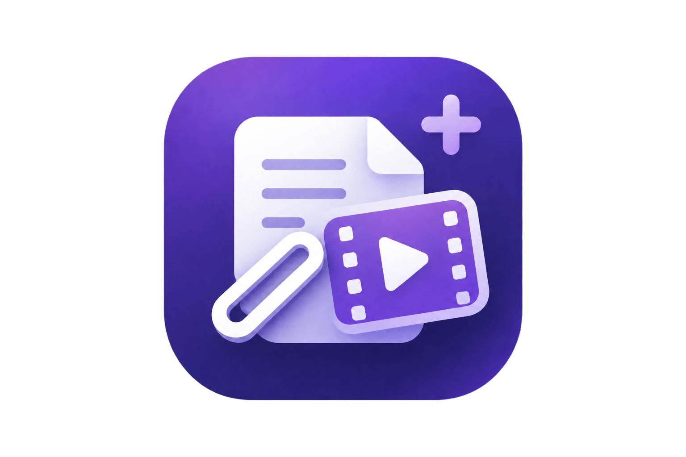

<p align="right">
  <a href="README.zh-CN.md"></a>
</p>

<p align="center">
  
</p>

<h1 align="center">Clipper Plus</h1>
<p align="center"><strong>Clip web pages and turn video speech into editable Markdown.</strong></p>
<p align="center">
  
  
  <a href="LICENSE"></a>
</p>
<p align="center">
  <a href="#features">Features</a> · <a href="#get-started">Get started</a> · <a href="#how-it-works">How it works</a> · <a href="#development">Development</a>
</p>

---

## What is Clipper Plus?

Clipper Plus extends [Obsidian Web Clipper](https://github.com/obsidianmd/obsidian-clipper) with an unsubtitled video transcription workflow. The familiar clipper handles ordinary web pages, templates, Reader, highlights, and saving to Obsidian or Markdown. On a video page, it can produce subtitle text extracted from the page whether the video contains subtitles or not.

The Chrome extension and Windows engine are both needed for local transcription. Ordinary web clipping can still be used when the engine is unavailable.

## Features

| Feature | What it does |
| --- | --- |
| Web clipping | Extract page content and metadata, apply templates, then save to Obsidian, copy, or download Markdown. |
| Video with subtitles | Use subtitle text already extracted by the clipper when available; choose whether to force audio transcription. |
| Video without subtitles | Download audio with yt-dlp, convert it with FFmpeg, and transcribe it locally with faster-whisper. |
| Editable Markdown | Produce a note with video metadata and timestamped transcript lines, then edit it in the clipper. |
| History | Reopen completed transcriptions from the local cache, search records, and manage them in Settings. |
| Reading tools | Keep the upstream Reader, highlighter, templates, and optional Interpreter features. |


## Get started

### Requirements

- Windows 10 or 11 and Google Chrome.
- At least 3 GiB of free disk space for Setup.
- Python 3.11–3.13 and the Python Launcher (`py`).
- FFmpeg and FFprobe available on `PATH`.

### Install from a Release

1. Download **dist.zip** from the [latest Release](https://github.com/callmepingping/Clipper-Plus/releases/latest) and extract it to a folder you will keep.
2. Open `chrome://extensions`, turn on **Developer mode**, and choose **Load unpacked**. Select the extracted `dist` folder containing `manifest.json`. Copy the 32-character extension ID shown by Chrome.
3. For local video transcription, download **Source code (zip)** from the same Release page and extract it to a folder you will keep. Run `setup/run-setup.bat` from that source folder, and enter the extension ID when prompted.
4. Open a video page and click the Clipper Plus toolbar icon. Use available page subtitles or choose forced transcription; when no subtitles are available, the local engine transcribes the audio.

Installing from the Release does not require Node.js or npm. The extension ZIP is loaded through Chrome's Developer mode; it is not a Chrome Web Store installer. Setup requires Deno 2.3.0 or later for YouTube and can offer to install it through `winget` if missing. Setup uses English prompts. Run `py -3 setup/main.py --check` from the extracted source folder for read-only diagnostics. If Chrome assigns a different extension ID after you move the extension, run Setup again with the new ID.

## How it works

```text
Web page ──> Chrome extension ──> extracted content / subtitles
                         │
                         └──> Native Messaging host
                                      │
                                      └──> Windows background engine
                                             ├── yt-dlp + FFmpeg: audio
                                             ├── faster-whisper: speech
                                             └── local Markdown cache + history
```

The Native Messaging host passes short requests to an independent engine over a per-user Windows named pipe. Closing the popup or Chrome does not stop an already running engine task. Task progress is transient; completed Markdown and history are stored under the local `runtime/` directory. Setup creates that directory, and Git ignores it.

### Data and current limits

- Audio transcription runs on the user's machine. yt-dlp still contacts the video source to obtain audio; model files may be downloaded on first use.
- Video content is not sent to a cloud summarization service by this workflow. The optional upstream Interpreter has its own provider settings.
- The engine processes one transcription task at a time. It does not resume an interrupted task after the engine or Windows exits.
- Video page detection and yt-dlp support both affect which sites work. Private, restricted, or DRM-protected content is not guaranteed to work.
- The local transcription engine is supported on Windows. Browser builds for other platforms do not provide this Windows engine.

## Development

| Path | Purpose |
| --- | --- |
| `extension/src/` | Browser extension UI and upstream clipper features |
| `extension/src/videomind/` | Video popup, native bridge, protocol, history, and rendering |
| `setup/` | Interactive installation and Windows host registration |
| `setup/engine/videomind/` | Background engine, transcription, IPC, storage, and cache |
| `runtime/` | Local user data created by Setup; excluded from Git |

```powershell
cd extension
npm ci
npm run typecheck
npm run test:videomind
npm run build:chrome
```

The Python tests use the standard library's `unittest` runner after the Setup environment is available:

```powershell
cd setup
.\.build\venv\Scripts\python.exe -m unittest discover -s tests -p "test_*.py" -q
```

Contributions and bug reports are welcome through [GitHub Issues](https://github.com/callmepingping/Clipper-Plus/issues). Please include the operating system, browser version, steps to reproduce, and any safe error code shown by the extension. Do not attach private video content, cookies, or local configuration files.

## Attribution and license

Clipper Plus is based on [Obsidian Web Clipper](https://github.com/obsidianmd/obsidian-clipper). See the [upstream source and attribution note](extension/VIDEOMIND_UPSTREAM.md) and the preserved [upstream MIT license](extension/LICENSE). Clipper Plus's own code is released under the [MIT License](LICENSE).
