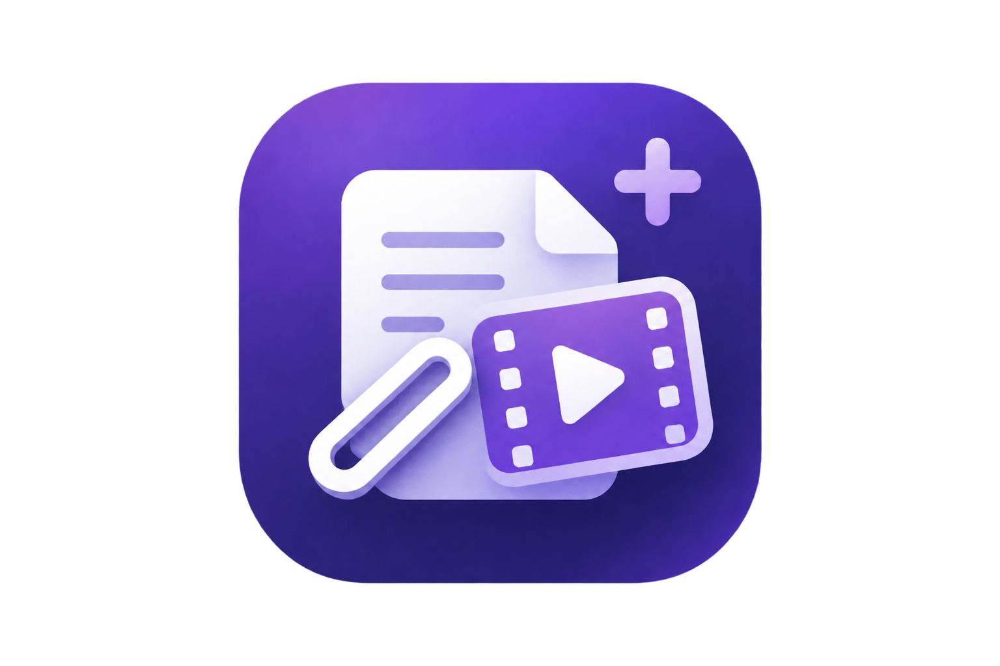

<p align="right">
  <a href="README.md"></a>
</p>

<p align="center">
  
</p>

<h1 align="center">Clipper Plus</h1>
<p align="center"><strong>剪藏网页，把视频语音变成可编辑的 Markdown。</strong></p>
<p align="center">
  
  
  <a href="LICENSE"></a>
</p>
<p align="center">
  <a href="#功能">功能</a> · <a href="#开始使用">开始使用</a> · <a href="#工作原理">工作原理</a> · <a href="#开发">开发</a>
</p>

---

## Clipper Plus 是什么？

Clipper Plus 基于 [Obsidian Web Clipper](https://github.com/obsidianmd/obsidian-clipper)，增加了对无字幕视频的剪藏功能。原有剪藏器负责普通网页、模板、阅读模式、高亮，以及保存到 Obsidian 或下载 Markdown。在视频页上，扩展可以使用从网页提取到的字幕文本，当视频无字幕时，独立的 Windows 引擎将自动用 faster-whisper 转写音频。

本地转写需要同时安装 Chrome 扩展和 Windows 引擎。即使引擎暂时不可用，普通网页剪藏仍可使用。

## 功能

| 功能 | 说明 |
| --- | --- |
| 网页剪藏 | 提取正文与元数据、应用模板，再保存到 Obsidian、复制或下载 Markdown。 |
| 视频字幕 | 网页已有字幕文本时直接使用，也可选择强制转写音频。 |
| 本地转写 | 当视频无字幕时，用 yt-dlp 下载音频、FFmpeg 转换，并在本机运行 faster-whisper。 |
| 可编辑的 Markdown | 生成含视频元数据和时间戳字幕的笔记，并在剪藏器中编辑。 |
| 历史记录 | 从本地缓存重新打开已完成的转写，在设置页搜索和管理记录。 |
| 阅读工具 | 保留上游的阅读模式、高亮、模板及可选的 Interpreter 功能。 |


## 开始使用

### 环境要求

- Windows 10 或 11，以及 Google Chrome。
- 至少 3 GiB 可用磁盘空间，供 Setup 检查和安装。
- Python 3.11–3.13，以及 Python Launcher（`py`）。
- `PATH` 中可找到 FFmpeg 和 FFprobe。

### 从 Release 安装

1. 从[最新 Release](https://github.com/callmepingping/Clipper-Plus/releases/latest) 下载 **dist.zip**，解压到一个固定目录。
2. 打开 `chrome://extensions`，启用**开发者模式**，点击**加载已解压的扩展程序**，选择解压后包含 `manifest.json` 的 `dist` 文件夹。复制 Chrome 显示的 32 位扩展 ID。
3. 如需本地视频转写，还要从同一 Release 页面下载 **Source code (zip)**，解压到一个固定目录。运行该源码目录中的 `setup/run-setup.bat`，按提示输入扩展 ID。
4. 打开视频页并点击 Clipper Plus 工具栏图标。可以使用网页已有字幕或选择强制转写；没有可用字幕时，本地引擎会转写音频。

安装 Release 版不需要 Node.js 或 npm。扩展 ZIP 通过 Chrome 开发者模式加载，不是 Chrome 网上应用店安装包。处理 YouTube 需要 Deno 2.3.0 或更新版本；Setup 在缺少时可以提示通过 `winget` 安装。Setup 当前使用英文提示。需要只读检查安装状态时，可在解压后的源码目录运行 `py -3 setup/main.py --check`。如果移动扩展导致 Chrome 分配了新的扩展 ID，需要用新 ID 重新运行 Setup。

## 工作原理

```text
网页 ──> Chrome 扩展 ──> 网页正文 / 已有字幕
                  │
                  └──> Native Messaging Host
                               │
                               └──> Windows 后台引擎
                                      ├── yt-dlp + FFmpeg：音频
                                      ├── faster-whisper：语音识别
                                      └── 本地 Markdown 缓存与历史记录
```

Native Messaging Host 通过当前用户的 Windows 命名管道，把短请求交给独立后台引擎。关闭弹窗或 Chrome 不会停止正在运行的引擎任务。任务进度只在引擎运行期间保留；已完成的 Markdown 和历史记录存放在本地 `runtime/` 目录。Setup 会创建该目录，Git 已将它排除。

### 数据与当前限制

- 语音识别在用户本机运行。yt-dlp 仍需连接视频来源获取音频；首次使用模型时可能下载模型文件。
- 视频转写流程不会把内容发送给云端摘要服务。上游可选的 Interpreter 有独立的模型提供商设置。
- 后台引擎一次只处理一个转写任务。引擎或 Windows 退出后，不会自动续接未完成的任务。
- 视频页识别规则与 yt-dlp 的支持情况共同决定哪些网站可用。私有、受限或受 DRM 保护的内容不保证可以处理。
- 本地转写引擎支持 Windows。其他平台的浏览器构建不包含这套 Windows 引擎能力。

## 开发

| 路径 | 用途 |
| --- | --- |
| `extension/src/` | 浏览器扩展界面与上游剪藏功能 |
| `extension/src/videomind/` | 视频弹窗、通信协议、历史记录与渲染 |
| `setup/` | 交互式安装与 Windows Host 注册 |
| `setup/engine/videomind/` | 后台引擎、转写、进程通信与缓存 |
| `runtime/` | Setup 创建的本地用户数据，已从 Git 排除 |

```powershell
cd extension
npm ci
npm run typecheck
npm run test:videomind
npm run build:chrome
```

Setup 环境准备好后，可用 Python 标准库的 `unittest` 运行测试：

```powershell
cd setup
.\.build\venv\Scripts\python.exe -m unittest discover -s tests -p "test_*.py" -q
```

欢迎通过 [GitHub Issues](https://github.com/callmepingping/Clipper-Plus/issues) 反馈问题或参与改进。请说明操作系统、浏览器版本、复现步骤，以及扩展显示的安全错误代码；不要上传私有视频内容、Cookie 或本地配置文件。

## 来源与许可证

Clipper Plus 基于 [Obsidian Web Clipper](https://github.com/obsidianmd/obsidian-clipper)。上游来源和版本见[来源说明](extension/VIDEOMIND_UPSTREAM.md)，上游 MIT 许可证见 [extension/LICENSE](extension/LICENSE)。Clipper Plus 自有代码采用 [MIT 许可证](LICENSE)。
